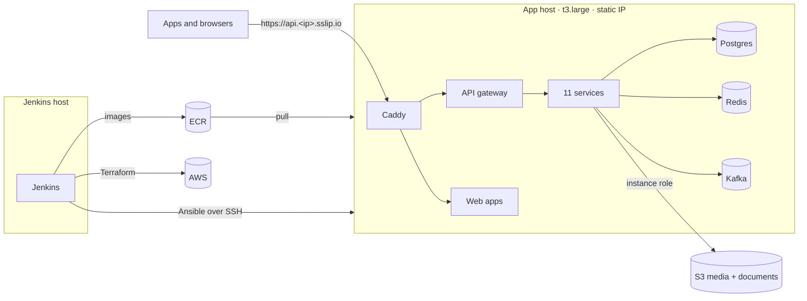

# delivery-plus-infra

The **dev environment** of Delivery Plus on AWS: one EC2 instance with a **static IP** runs the whole backend (12 services, Postgres, Redis, Kafka, Zookeeper) in Docker Compose, behind Caddy with automatic HTTPS. It also serves the customer, driver and restaurant web apps. Jenkins builds, tests and deploys it.

- **Terraform** creates the AWS side: network, EC2 + Elastic IP + EBS data volume, S3 buckets, ECR, IAM.
- **Ansible** configures the hosts and deploys releases.
- **Jenkins** runs the pipelines: lint and test, Terraform plan/apply, Ansible, build and deploy, stop/start.
- **No AWS-managed data services:** Kafka, Postgres and Redis are containers whose data lives on the EBS volume. AWS provides only EC2, EBS, S3 and ECR.



## Contents

```
terraform/
  bootstrap/            state bucket (once per account)
  modules/              network · host (EC2, Elastic IP, data volume, role) · app-storage (S3) · ecr
  stacks/platform/      VPC, ECR, deploy key, Jenkins host — applied by an admin
  stacks/dev/           app host with static IP, S3 buckets, app role — applied by Jenkins
ansible/
  inventories/dev/      dynamic inventory from EC2 tags, group_vars
  roles/                common · docker · data_volume · app_host · app_deploy · jenkins
  playbooks/            site · jenkins · app · deploy
compose/
  docker-compose.ec2.yml   overlay on the backend's own compose files (ECR images, Kafka, Caddy, data volume)
jenkins/
  controller/           Jenkins image (LTS + plugins + Docker CLI)
  pipelines/            ci · terraform · ansible · deploy · power
scripts/                build-images, smoke-test, env-info, tf-init, caddy-routes
tests/                  compose rules, template rendering, web routes (+ terraform/**/tests)
ci/tools.Dockerfile     the tools image every pipeline runs in
docs/                   architecture, bootstrap, pipelines, configuration, runbook
```

## Docs

| | |
| --- | --- |
| [Architecture](docs/architecture.md) | Diagrams of AWS and the app host, the security decisions, why two Terraform stacks |
| [First-time setup](docs/bootstrap.md) | From an empty AWS account to a running environment |
| [Pipelines](docs/pipelines.md) | The Jenkins jobs, what each checks and deploys, credentials |
| [Configuration](docs/configuration.md) | Every environment variable and where it comes from; common changes |
| [Runbook](docs/runbook.md) | Logs, Kafka, database, rollback, stop/start, certificates, secrets, backups, teardown, cost |

## Checks

```bash
make lint test          # everything CI runs (needs the tools; or:)
make docker-check       # the same, inside ci/tools.Dockerfile
```

The Terraform tests run plan-only with fake credentials, so they need no AWS account.

## Rules

- This repository is **public**. Secrets are generated on the hosts and never committed: no `.env`, keys, tfvars or state.
- Changes go through a pull request to `dev`, with CI green.
- MIT licensed, like the rest of Delivery Plus: see [LICENSE](LICENSE).
- The backend's business rules aren't configured here; the environment runs the backend as committed.
