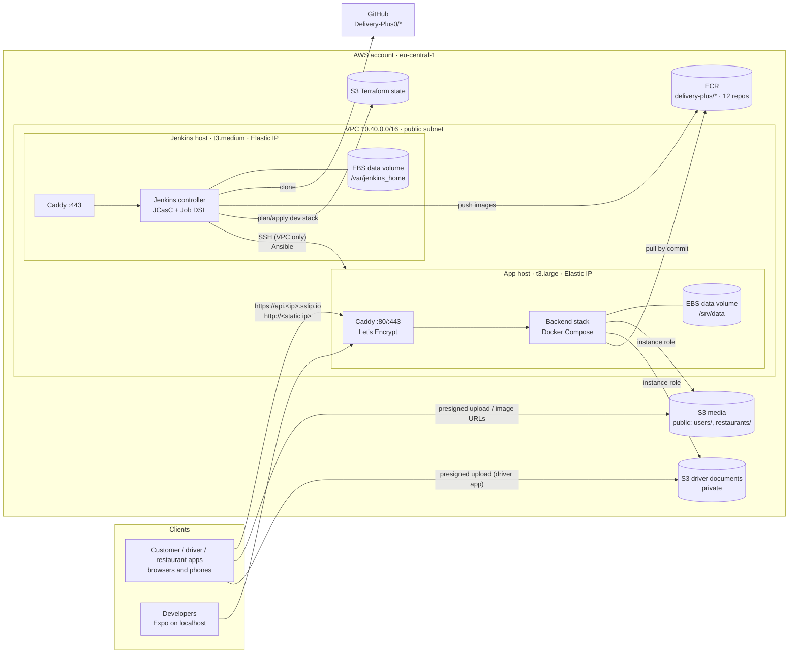
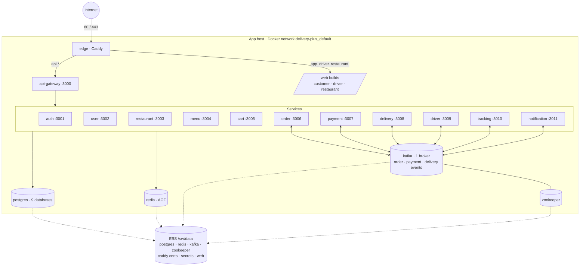
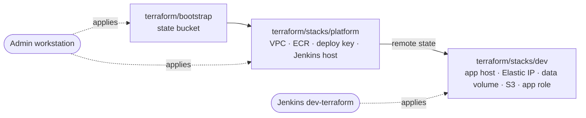

# Architecture

The dev environment runs the whole Delivery Plus backend on **one EC2 instance with a static IP**, in Docker Compose. Postgres, Redis, Zookeeper and Kafka are containers next to the 12 services: there's no RDS, ElastiCache or MSK. AWS provides only the machine (EC2 and EBS), the image registry (ECR) and object storage (S3).

A second, smaller instance runs **Jenkins**, which applies Terraform, runs Ansible and deploys.

## AWS

- **The static IP** is an Elastic IP: it stays the same through stops, reboots and instance replacements, and changes only if the dev stack is destroyed.
- **DNS without a domain:** `api.<a-b-c-d>.sslip.io` resolves to `a.b.c.d`, so Caddy gets real Let's Encrypt certificates for the static IP. To use a real domain instead, set `base_domain` in the dev stack and point `api.`, `app.`, `driver.` and `restaurant.` at the IP.
- **The bare IP** works too: `http://<static ip>/` goes to the API gateway, for tools that want an address rather than a name.

## The app host

- The compose files are the **backend's own** (`docker-compose.base.yml` and `docker-compose.prod.yml` at the deployed commit) plus [`compose/docker-compose.ec2.yml`](../compose/docker-compose.ec2.yml). The overlay switches the images to ECR, publishes only Caddy, binds the data to the EBS volume, sizes Kafka and Postgres for 8 GiB, and sets memory limits.
- **Kafka topics** (`order.events`, `payment.events`, `delivery.events` and their `.dlq` topics) are created up front with 3 partitions by the one-shot `kafka-init` service, as the backend's deployment doc asks.
- **Nothing stateful lives in a container:** a replaced instance mounts the same EBS volume and finds its databases, Kafka log, certificates and generated secrets.

## Security decisions

| Topic | Decision |
| --- | --- |
| Inbound traffic | App host: 80/443 from anywhere (Caddy), SSH from `admin_cidrs` and from Jenkins' security group only. Postgres, Redis, Kafka and the services are never published. |
| S3 credentials | The services use the **instance role** (IMDSv2, hop limit 2 so containers reach it). No access keys exist. |
| S3 permissions | Media: get/put in `pending/`, `users/`, `restaurants/`. Driver documents: get/put in `pending/drivers/*` and `drivers/*` only, as backend #207 specifies. `ListBucket` only on `pending/` (so a missing upload reads as 404). No deletes. |
| Buckets | Documents bucket: Block Public Access fully on, versioned, no grants. Media bucket: public read only on confirmed prefixes; `pending/` expires after a day. Both deny non-TLS. |
| Secrets | Generated once on the host (48 random characters each) and stored root-only on the data volume. They never pass through git, Jenkins or logs (`no_log`). |
| Jenkins' AWS rights | ECR push, the dev stack's state, EC2 in the region, and IAM/S3 **only** under `delivery-plus-dev*`. Jenkins can't modify its own role or the platform stack. |
| Jenkins UI | HTTPS through Caddy, login required for everything, no sign-up, CSRF protection on. |
| SSH | Keys only, no root login, no passwords. |

## Why two Terraform stacks

Jenkins runs on the platform stack, so it must never apply that stack: a bad plan could replace the machine the build runs on. An admin applies **platform** by hand, rarely. Jenkins applies **dev** as often as needed.
