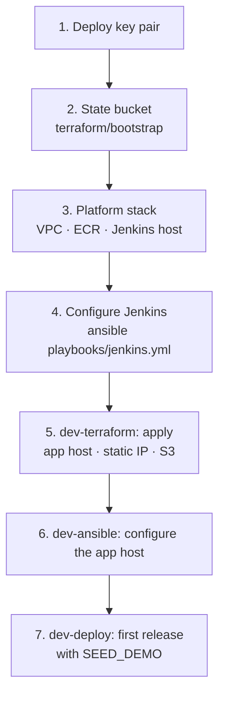

# First-time setup

This runs once per AWS account, from an admin workstation, and takes about 30 minutes. Afterwards, everything goes through Jenkins.



## Before you start

- **AWS:** credentials for an administrator of the target account (an SSO profile or an admin user), exported as usual, e.g. `export AWS_PROFILE=delivery-plus-admin`.
- **The backend change:** `docker-compose.prod.yml` must accept running without AWS keys. That is Delivery-Plus0/delivery-plus#301; it must be merged to `dev` before the first deploy.
- **Tools:** Terraform 1.10 or newer, Python 3.12, and `pip install -r ci/requirements.txt` (Ansible with its collections, boto3, the AWS CLI). Or run everything inside the tools image:
  ```bash
  docker build -f ci/tools.Dockerfile -t delivery-plus-infra-tools .
  docker run --rm -it -v "$PWD:/work" -v ~/.aws:/home/tools/.aws:ro -v ~/.ssh:/home/tools/.ssh:ro \
    -e AWS_PROFILE delivery-plus-infra-tools bash
  ```
- **Your public IP** for SSH access: `curl -s https://checkip.amazonaws.com`.
- **Region:** `eu-central-1` (Frankfurt) by default. If you choose another, set it in every `terraform.tfvars` and in [`ansible/inventories/dev/aws_ec2.yml`](../ansible/inventories/dev/aws_ec2.yml) (`regions`).

## 1. Deploy key pair

Ansible uses this key to reach both hosts. The public half goes to Terraform, and the private half goes into Jenkins (step 4).

```bash
ssh-keygen -t ed25519 -f ~/.ssh/delivery-plus-deploy -C delivery-plus-deploy -N ''
```

## 2. State bucket

```bash
terraform -chdir=terraform/bootstrap init
terraform -chdir=terraform/bootstrap apply
terraform -chdir=terraform/bootstrap output state_bucket   # e.g. delivery-plus-tfstate-123456789012
```

The bootstrap's own state stays in `terraform/bootstrap/terraform.tfstate`, which is git-ignored. Keep it, or re-import the bucket if it's lost.

## 3. Platform stack

```bash
cd terraform/stacks/platform
cp backend.hcl.example backend.hcl                 # set bucket
cp terraform.tfvars.example terraform.tfvars       # set state_bucket, admin_cidrs, ssh_public_key
terraform init -backend-config=backend.hcl
terraform apply
terraform output                                   # jenkins_url, jenkins_public_ip, ecr_registry
cd -
```

Commit the generated `.terraform.lock.hcl` files after the first real `init`. They pin the provider builds.

## 4. Configure Jenkins

```bash
cd ansible
ansible-inventory --graph                          # the Jenkins host appears under @jenkins
DEPLOY_KEY_FILE=~/.ssh/delivery-plus-deploy \
  ansible-playbook playbooks/jenkins.yml --private-key ~/.ssh/delivery-plus-deploy
```

The playbook prints the URL, `https://jenkins.<jenkins-ip>.sslip.io/`. To sign in as `admin`, read the password on the host:

```bash
ssh -i ~/.ssh/delivery-plus-deploy ubuntu@<jenkins-ip> sudo cat /opt/jenkins/secrets/JENKINS_ADMIN_PASSWORD
```

## 5. Create the dev environment

In Jenkins, run **dev-terraform** with `ACTION=apply`, review `tfplan.txt`, and approve. The first run creates:
- the app host (t3.large) with its static IP and data volume;
- the media and driver-documents buckets;
- the app host's role.

The static IP is printed in the outputs (`app_public_ip`) and stays the same from now on.

## 6. Configure the app host

Run **dev-ansible** once with `CHECK_MODE` on to preview the changes, then again with it off. This installs:
- Docker, with ECR pulls through the instance role;
- the data volume;
- the generated secrets and the `.env`;
- Caddy's configuration and `dp-compose`.

## 7. First release

Run **dev-deploy** with `BACKEND_REF=dev` and `SEED_DEMO` on. The first run takes the longest (about 25 minutes): it builds 12 images and three web apps. After that, unchanged images are skipped.

When it finishes, the build log lists:

| | URL |
| --- | --- |
| API | `https://api.<ip-with-dashes>.sslip.io` (and `http://<static ip>`) |
| Customer app | `https://app.<ip-with-dashes>.sslip.io` |
| Driver app | `https://driver.<ip-with-dashes>.sslip.io` |
| Restaurant app | `https://restaurant.<ip-with-dashes>.sslip.io` |

The backend's first super admin is `admin@<ip-with-dashes>.sslip.io`. Its password is the `dev-admin` credential, which is also on the Jenkins host at `/opt/jenkins/secrets/DEV_ADMIN_PASSWORD`. Use it for the staff steps, for example approving restaurants and drivers.

## Pointing the mobile apps at the dev environment

Set `EXPO_PUBLIC_API_BASE_URL=https://api.<ip-with-dashes>.sslip.io` in the app's `.env` (the app repositories' README), and restart Expo. `http://localhost:8081`–`8083` are already allowed by CORS for Expo on a developer machine.
