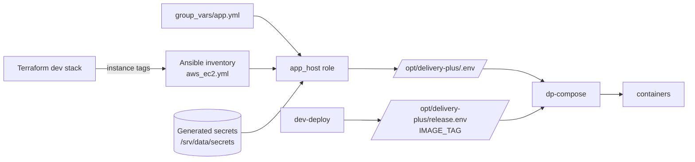

# Configuration

Every setting has one source: Terraform for anything about AWS, the inventory's `group_vars` for host choices, and the host itself for generated secrets. Ansible joins them in `/opt/delivery-plus/.env` on the app host (root only). Docker Compose reads that file, along with `release.env` from the latest deploy.

## How a value reaches a container

## The app host's `.env`

| Variable | Dev value | Source |
| --- | --- | --- |
| `COMPOSE_PROJECT_NAME` | `delivery-plus` | `group_vars/app.yml` (`app_compose_project`) |
| `DATA_DIR` | `/srv/data` | Terraform (`DataMount` tag) |
| `ECR_REGISTRY` | `<account>.dkr.ecr.<region>.amazonaws.com` | Terraform (`Registry` tag) |
| `POSTGRES_USER` / `_URLENCODED` | `delivery_plus` | `group_vars/app.yml` |
| `POSTGRES_PASSWORD` / `_URLENCODED` | 48 random characters | Generated on the host |
| `JWT_SECRET`, `SYSTEM_JWT_SECRET`, `INTERNAL_AUTH_SECRET`, `NATIONAL_ID_HMAC_SECRET`, `EMAIL_CODE_HASH_SECRET`, `OTP_HASH_SECRET` | 48 random characters each | Generated on the host |
| `CORS_ORIGINS` | the three app origins, plus `localhost:8081-8083` | `base_domain` (tag) plus `extra_app_origins` (dev stack variable) |
| `TRUSTED_PROXY_HOPS` | `1` (Caddy) | `group_vars/app.yml` |
| `AWS_REGION` | `eu-central-1` | Terraform (`Region` tag) |
| `AWS_S3_BUCKET` | `delivery-plus-dev-media-<account>` | Terraform (`MediaBucket` tag) |
| `AWS_PUBLIC_BASE_URL` | `https://<media bucket>.s3.<region>.amazonaws.com` | Terraform (`MediaBaseUrl` tag) |
| `DRIVER_DOCUMENTS_BUCKET` | `delivery-plus-dev-documents-<account>` | Terraform (`DocumentsBucket` tag) |
| `EMAIL_PROVIDER` | `disabled` (`ses` when the dev stack enables SES) | `enable_ses` / `ses_from_address` |
| `SES_FROM_ADDRESS` | empty | Terraform (`SesFromAddress` tag) |
| `SMS_PROVIDER` | `disabled` | `group_vars/app.yml` |
| `PHONE_VERIFICATION_REQUIRED` | `false` | `group_vars/app.yml` |
| `DEFAULT_DELIVERY_RADIUS_KM` | `5` | `group_vars/app.yml` |
| `IMAGE_TAG` (`release.env`) | the backend commit, 12 characters | `dev-deploy` |

There are no AWS keys anywhere. The services use the app host's instance role, through the AWS SDK's default credential chain.

The internal service URLs (`http://order-service:3006`…), Redis, Kafka (`kafka:29092`) and the per-service database URLs come from the backend's `docker-compose.prod.yml`, so they always match the deployed commit.

## Common changes

| To | Change | Then run |
| --- | --- | --- |
| Use your own domain | `base_domain` in the dev stack, plus DNS records for `api.`, `app.`, `driver.` and `restaurant.` pointing at the static IP | `dev-terraform` (apply), `dev-ansible`, `dev-deploy` (the web apps embed the API URL) |
| Send email codes | Verify a sender in SES, then set `enable_ses = true` and `ses_from_address` | `dev-terraform`, `dev-ansible` |
| Allow another browser origin | `extra_app_origins` in the dev stack | `dev-terraform`, `dev-ansible` |
| Resize the app host | `app_instance_type` in the dev stack (the data volume stays) | `dev-terraform` (the instance stops briefly) |
| Change the delivery radius default | `app_config.default_delivery_radius_km` in `group_vars/app.yml` | `dev-ansible` |
| Rotate a secret | Delete its file in `/srv/data/secrets` | `dev-ansible`. **Read [the runbook](runbook.md#rotating-a-secret) first.** Some secrets invalidate sessions or data. |

## Kafka

| Setting | Value | Where |
| --- | --- | --- |
| Brokers | 1 (`kafka:29092` on the Docker network only) | backend `docker-compose.base.yml` |
| Heap | 512 MiB (Zookeeper 256 MiB) | `compose/docker-compose.ec2.yml` |
| Topics | `order.events`, `payment.events`, `delivery.events` and their `.dlq` topics, 3 partitions each | `kafka-init` in `compose/docker-compose.ec2.yml` |
| Retention | 7 days (dead letters 14 days) | `compose/docker-compose.ec2.yml` |
| Replication | 1 (single broker) | `compose/docker-compose.ec2.yml` |
| Data | `/srv/data/kafka`, `/srv/data/zookeeper` on the EBS volume | `compose/docker-compose.ec2.yml` |
