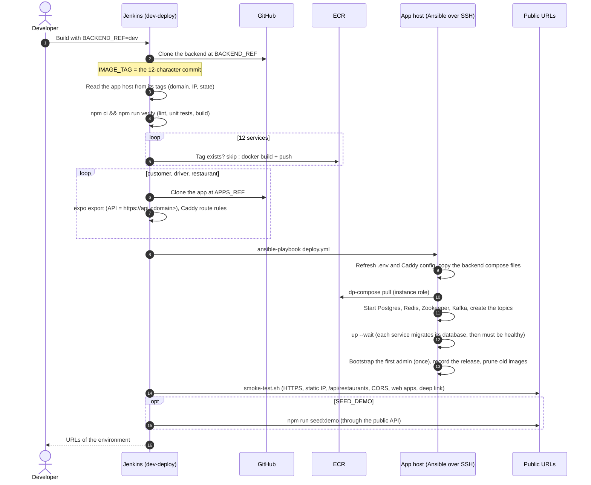
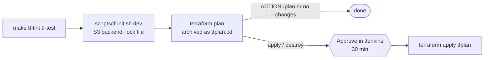

# Jenkins pipelines

Jenkins is configured entirely from this repository: JCasC and Job DSL are templated by [`ansible/roles/jenkins`](../ansible/roles/jenkins), and the pipelines live in [`jenkins/pipelines`](../jenkins/pipelines). UI changes are overwritten on the next restart.

Every pipeline runs its steps in containers on the Jenkins host's Docker:
- the **tools image** ([`ci/tools.Dockerfile`](../ci/tools.Dockerfile)): Terraform, TFLint, Ansible, the AWS CLI, Docker, Caddy and the linters;
- **`node:22-bookworm`** for the backend tests, the web builds and the demo seed.

AWS access comes from the Jenkins host's instance role. No AWS keys are stored in Jenkins.

| Job | What it does | Parameters |
| --- | --- | --- |
| `infra-ci` | Lint and test this repository, on every branch (polled every 5 minutes) | none |
| `dev-terraform` | Plan the dev stack. On approval, apply or destroy it | `ACTION` (plan, apply, destroy), `CONFIRM_DESTROY` |
| `dev-ansible` | Configure the app host (check mode by default) | `CHECK_MODE` |
| `dev-deploy` | Test, build, push, deploy, smoke-test a backend commit and the web apps | `BACKEND_REF`, `APPS_REF`, `RUN_BACKEND_TESTS`, `BUILD_WEB_APPS`, `SEED_DEMO` |
| `dev-power` | Stop or start the app host (the static IP and the data stay) | `ACTION` (status, start, stop) |

## infra-ci: lint and test

`make lint test` runs inside the tools image. The same command runs in the GitHub workflow for pull requests.

| Check | Tool |
| --- | --- |
| Terraform formatting, validation, linting | `terraform fmt -check`, `terraform validate`, TFLint with the AWS ruleset |
| Terraform behavior | `terraform test`: 20 plan-only tests with fake credentials, so no AWS account is needed. They cover the security group rules, IMDSv2, encryption, the bucket privacy and IAM scopes, the domain naming, and the input validation. |
| Ansible | `ansible-lint` with the production profile, plus `--syntax-check` of the playbooks |
| YAML, shell, Dockerfiles, Python | yamllint (strict), ShellCheck, Hadolint, `py_compile` |
| Compose overlay | [`tests/compose-config.sh`](../tests/compose-config.sh) merges it with the backend's real compose files in a clean environment. It then checks: images from ECR at the release tag, nothing published but Caddy, no AWS keys, data on the data volume, a Kafka heap limit, and the proxy hop setting. |
| Ansible templates | [`tests/templates.sh`](../tests/templates.sh) renders them with fixtures. Caddy validates the Caddyfiles, `docker compose` validates the compose file, YAML is parsed, and the `.env` is checked against what the compose files need. |
| Web routing | [`tests/web-routes.sh`](../tests/web-routes.sh) serves a miniature Expo export with real Caddy and checks deep links to dynamic routes. |

## dev-deploy

- **Rollback:** run `dev-deploy` with `BACKEND_REF` set to an earlier commit. Its images are still in ECR (the newest 15 per service are kept), so nothing is rebuilt. Database migrations are forward-only (backend `docs/deployment.md`), so a rollback across a migration needs care.
- **If the deploy fails**, Ansible prints which services aren't healthy and their last log lines, and the build fails. The previous containers of an unchanged service keep running.

## dev-terraform

Destroy also requires `CONFIRM_DESTROY=delivery-plus-dev`. It deletes the app host, its data volume, its Elastic IP and both buckets, with everything in them.

## Credentials in Jenkins

All of them come from JCasC. Their values are files on the Jenkins host (`/opt/jenkins/secrets`, root-owned) and never live in this repository.

| ID | Kind | Used by |
| --- | --- | --- |
| `app-ssh` | SSH private key (`ubuntu`) | `dev-ansible`, `dev-deploy`: Ansible to the app host |
| `dev-admin` | Username and password | `dev-deploy`: bootstraps the backend's first super admin, and signs in for the demo seed |

## Global environment (JCasC)

`ENVIRONMENT`, `AWS_REGION`, `STATE_BUCKET`, `ECR_REGISTRY`, `DOCKER_GID`, `INFRA_REPO`, `BACKEND_REPO`, `CUSTOMER_APP_REPO`, `DRIVER_APP_REPO`, `RESTAURANT_APP_REPO`. They are read from the Jenkins host's tags and [`group_vars/jenkins.yml`](../ansible/inventories/dev/group_vars/jenkins.yml).
